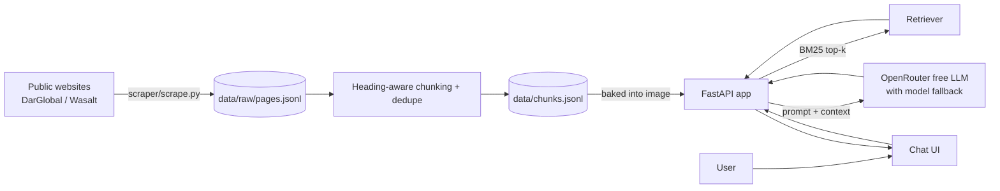

# DarGlobal & Wasalt Assistant: RAG Chatbot

A retrieval-augmented chatbot that answers questions about **DarGlobal** and **Wasalt** using data scraped from their public websites. It is containerised with Docker and deployed on Render.

**Live demo:** `<paste your Render URL here>`  |  **Health check:** `<URL>/health`

## Architecture



## Design decisions

| Area | Choice | Why |
|---|---|---|
| Scraping | `requests` + BeautifulSoup, sitemap discovery, robots.txt, 1s delay, retries with backoff | Polite, reproducible, no heavy dependencies. Optional Playwright fallback (`--browser`) for JS-rendered pages |
| Chunking | Split by page headings, ~170 words with 30-word overlap, MD5 dedupe | Keeps each chunk topically coherent and avoids repeated nav/footer text |
| Retrieval | BM25 (`rank-bm25`) with company-aware filtering | Fits free-tier memory, fast cold start, strong for keyword-heavy company facts. An embedding retriever could be swapped in behind `Retriever.search` |
| LLM | OpenRouter `:free` models, tried in order | Free-model availability and rate limits change, so a fallback list keeps the bot up |
| Grounding | System prompt restricts answers to retrieved context and requires an "I don't have that" answer otherwise | Reduces hallucination; sources are returned with every answer |
| Serving | FastAPI + static chat UI, input validation, structured logging, `/health` | Simple and observable |
| Container | `python:3.12-slim`, non-root user, `HEALTHCHECK` | Small image and safe defaults |

## Repository layout
```
app/            FastAPI service (main.py), retriever (rag.py), chat UI (static/)
scraper/        Crawler and chunker (scrape.py)
data/           chunks.jsonl (used at runtime), raw/pages.jsonl (scrape output)
tests/          Unit tests (pytest)
eval/           End-to-end question set (run_eval.py)
Dockerfile, render.yaml, requirements*.txt
```

## Quick start
```bash
pip install -r requirements.txt -r requirements-dev.txt

# 1. Scrape (writes data/raw/pages.jsonl and data/chunks.jsonl)
python -m scraper.scrape --max-pages 80
#    JS-heavy pages? pip install playwright && playwright install chromium, then add --browser

# 2. Test
pytest -q

# 3. Run
export OPENROUTER_API_KEY=sk-or-v1-...
uvicorn app.main:app --reload            # http://localhost:8000

# 4. Evaluate
python eval/run_eval.py http://localhost:8000
```

## Docker
```bash
docker build -t dar-wasalt-chatbot .
docker run -p 8000:8000 -e OPENROUTER_API_KEY=sk-or-v1-... dar-wasalt-chatbot
```

## Deploy on Render
1. Push to GitHub (`.env` is git-ignored).
2. Render: New > Web Service > select the repo > Runtime **Docker** (reads `render.yaml`).
3. Set `OPENROUTER_API_KEY` in Environment.
4. After deploy, verify `/health` shows `"key_set": true` and the expected chunk count.

## Configuration
| Variable | Purpose |
|---|---|
| `OPENROUTER_API_KEY` | Required |
| `OPENROUTER_MODELS` | Optional comma-separated model IDs tried in order. See https://openrouter.ai/models?q=free |
| `PORT` | Injected by the host (default 8000) |

## API
- `GET /health` returns status, chunk count and configured models.
- `POST /chat` takes `{"message": "...", "history": [{"role": "user|assistant", "content": "..."}]}` and returns `{"answer", "sources", "model"}`.

## Limitations and next steps
- The knowledge base is a snapshot; re-run the scraper and redeploy to refresh it.
- Listing pages (thousands of property cards) are deliberately excluded; only company, product and editorial content is indexed.
- Free models can be rate-limited or slow; the free Render tier sleeps when idle, so the first request may take about a minute.
- Next steps: hybrid BM25 + embeddings retrieval, streaming responses, a scheduled re-scrape, and an LLM-judged evaluation.

## Compliance
Only publicly accessible pages are collected, robots.txt is honoured, requests are rate-limited, and the user agent identifies the bot. Respect each site's terms of use before scaling up the crawl.
