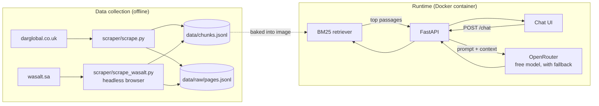

# DarGlobal & Wasalt Property Assistant

A retrieval-augmented chatbot that answers questions about **DarGlobal** and **Wasalt** using information collected from their public websites. Every answer cites the pages it came from.

| | |
|---|---|
| **Live demo** | https://darglobal-wasalt-chatbot-latest.onrender.com/ |
| **Health check** | https://darglobal-wasalt-chatbot-latest.onrender.com/health |
| **Stack** | Python, FastAPI, BM25 retrieval, OpenRouter (free models), Docker, GitHub Actions, Render |

> The demo runs on a free hosting tier that sleeps when idle. The first request after a quiet period can take up to a minute; later requests are fast.

## Features

- **Grounded answers.** The model sees only retrieved passages from the collected pages and is instructed to say when the answer is not in them.
- **Source citations.** Each answer lists the pages it used, colour-coded by company (brass for DarGlobal, emerald for Wasalt).
- **Resilient model access.** Free OpenRouter models are tried in order, so one rate-limited model does not take the bot down.
- **Polished chat UI.** Dark theme, formatted answers (bold, lists), typing indicator, retry on error, and a responsive layout for phones.
- **Automated delivery.** Every push to `main` is tested, built into a Docker image and redeployed.

## Architecture



**Request flow:** the browser posts the question and recent history to `/chat`. The server detects whether the question names one company, retrieves the best-matching passages (restricted to that company if named), builds a prompt containing only those passages, calls an OpenRouter model, and returns the answer with the source URLs.

## Data collection

Data comes only from publicly accessible pages of the two companies' own websites.

| Source | How it is collected |
|---|---|
| DarGlobal | `scraper/scrape.py` crawls the public site from seed pages and its sitemap. |
| Wasalt | `scraper/scrape_wasalt.py` renders company and product pages in a headless browser (the pages are JavaScript-rendered), reads the static sitemap and the site's `llms.txt`. |

Pipeline: discover URLs, fetch, extract the main content grouped by heading, split into overlapping chunks (about 170 words with a 30-word overlap), remove duplicates, and write JSON Lines.

**Responsible crawling**

- `robots.txt` is fetched per host and obeyed. A missing file (404) means no restrictions; an unreadable policy (403, 5xx, network error) means the site is not crawled.
- Requests are rate-limited and retried with backoff.
- The user agent identifies the bot and can carry your contact address via `SCRAPER_CONTACT`.
- Wasalt property listings (thousands of near-identical pages) are excluded by default. Only company, product and editorial content is indexed. A small rendered listing sample is optional (`--listings N`).

**Outputs**

- `data/raw/pages.jsonl`: one record per fetched page (URL, title, text, timestamp).
- `data/chunks.jsonl`: the retrieval chunks used by the chatbot.

## Design decisions

| Area | Choice | Reason |
|---|---|---|
| Retrieval | BM25 (`rank-bm25`) with company-aware filtering | Strong for keyword-heavy company facts, no model download, fast cold start on a small instance. An embedding retriever can be swapped in behind `Retriever.search`. |
| Chunking | By heading, overlapping, de-duplicated | Keeps each chunk on one topic and avoids repeated navigation text. |
| Model | OpenRouter `:free` models with an ordered fallback list | Free availability and rate limits change; fallback keeps the service up. |
| Grounding | Prompt restricts answers to the retrieved context and requires an "I don't have that" answer otherwise | Reduces invented facts. Sources are returned with every answer. |
| Container | `python:3.12-slim`, non-root user, health check | Small image, safe defaults. |
| Delivery | GitHub Actions to GitHub Container Registry to Render | Build and deploy without a local Docker install. |

## Repository layout

```
app/
  main.py            FastAPI service: /, /chat, /health, prompt and model fallback
  rag.py             BM25 retriever over data/chunks.jsonl
  static/index.html  Chat UI (HTML, CSS and JavaScript in one file)
scraper/
  scrape.py          Crawler and chunker
  scrape_wasalt.py   Headless-browser collector for Wasalt
data/
  chunks.jsonl       Retrieval data used at runtime
  raw/pages.jsonl    Raw scraped pages
tests/               Unit tests (pytest)
eval/run_eval.py     End-to-end question set against a running server
.github/workflows/   CI/CD pipeline
Dockerfile
render.yaml
```

## Run locally

Requirements: Python 3.12 and an [OpenRouter](https://openrouter.ai) API key.

```bash
python -m venv .venv && source .venv/bin/activate
pip install -r requirements.txt -r requirements-dev.txt

export OPENROUTER_API_KEY=sk-or-v1-...
uvicorn app.main:app --reload          # http://localhost:8000
```

**Refresh the data (optional)**

```bash
export SCRAPER_CONTACT="you@example.com"      # shown in the user agent

python -m scraper.scrape --max-pages 100      # crawl; rewrites data/chunks.jsonl

pip install playwright && playwright install chromium
python -m scraper.scrape_wasalt               # render Wasalt pages; replaces Wasalt rows only
```

Run `scrape.py` first, then `scrape_wasalt.py`: the first rewrites the chunk file, the second replaces the Wasalt rows in it.

**Test and evaluate**

```bash
pytest -q tests
python eval/run_eval.py http://localhost:8000
```

`eval/run_eval.py` asks a fixed set of questions with known answers (plus one off-topic question that should be declined) and reports pass or fail for each.

## Docker

```bash
docker build -t dar-wasalt-chatbot .
docker run -p 8000:8000 -e OPENROUTER_API_KEY=sk-or-v1-... dar-wasalt-chatbot
```

## CI/CD and deployment

`.github/workflows/deploy.yml` runs on every push to `main`:

1. **test**: installs dependencies, runs the unit tests, and checks that the data file contains both companies.
2. **build-and-push**: builds the Docker image and publishes it to `ghcr.io/<owner>/<repo>`.
3. **deploy**: calls the Render deploy hook so the service pulls the new image.

**One-time setup**

1. Make the container package public (GitHub profile, Packages, package settings, change visibility).
2. In Render, create a Web Service from the existing image `ghcr.io/<owner>/<repo>:latest`, set the health check path to `/health`, and add the environment variable `OPENROUTER_API_KEY`.
3. Copy the service's Deploy Hook URL into a GitHub repository secret named `RENDER_DEPLOY_HOOK`.

## Configuration

| Variable | Required | Purpose |
|---|---|---|
| `OPENROUTER_API_KEY` | Yes | API key for OpenRouter |
| `OPENROUTER_MODELS` | No | Comma-separated model IDs tried in order. Browse free models at https://openrouter.ai/models?q=free |
| `PORT` | No | Injected by the host; defaults to 8000 |
| `SCRAPER_CONTACT` | No | Contact address included in the scraper's user agent |

Secrets are never committed: `.env` is git-ignored and the key is supplied as an environment variable on the host.

## API

**`GET /health`**: service status, number of loaded chunks, configured models, and whether an API key is set.

**`POST /chat`**

```json
{
  "message": "What is Wasalt Auction?",
  "history": [{ "role": "user", "content": "..." }, { "role": "assistant", "content": "..." }]
}
```

Response:

```json
{
  "answer": "...",
  "sources": ["https://wasalt.sa/en/corporate"],
  "model": "provider/model-name:free"
}
```

Limits: `message` is 1 to 1000 characters and `history` holds at most 20 entries. Errors return a JSON `detail` message.

## Limitations

- **Snapshot of public pages.** The knowledge base reflects the pages at collection time. Re-run the scrapers and redeploy to refresh it.
- **Coverage.** Only company and product content is indexed; individual property listings are not, so the bot cannot search available properties.
- **Keyword retrieval.** BM25 matches words, not meaning, so heavily paraphrased questions can miss relevant passages.
- **Free infrastructure.** Free models can be slow or rate-limited, and the free hosting tier sleeps when idle.
- **Unofficial.** This is an independent demo built from public information and is not affiliated with DarGlobal or Wasalt.

## Possible next steps

- Hybrid retrieval (BM25 plus embeddings) with a re-ranker.
- Streaming responses.
- Scheduled re-scraping with a change report.
- A larger evaluation set with automated scoring.